# E-Commerce Sales Performance Dashboard

## Dashboard Preview

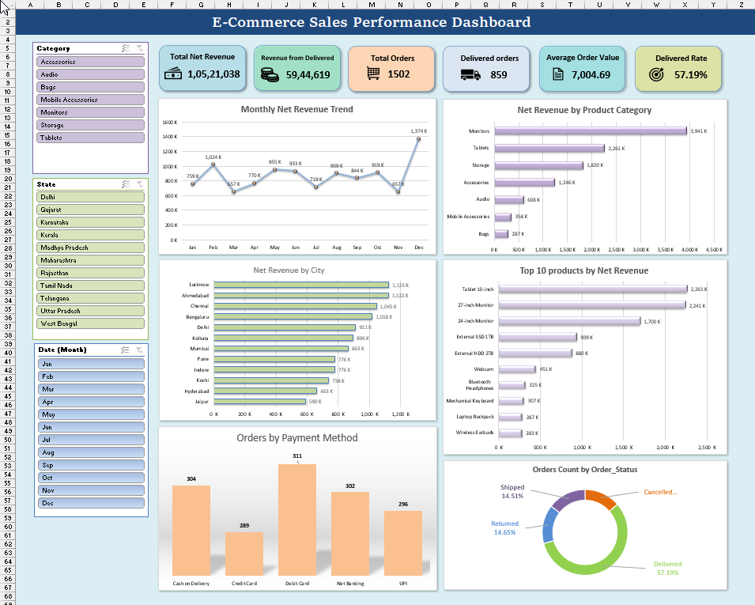

An end-to-end e-commerce sales analysis project built in Microsoft
Excel. The project combines data cleaning, data-quality investigation,
data modelling, DAX calculations, PivotTables, PivotCharts, and an
interactive dashboard to explore sales performance across products,
locations, order statuses, payment methods, and time.

## Project Overview

The objective was to turn a raw e-commerce order dataset into a cleaned,
structured, and interactive reporting workbook. The analysis focuses on
revenue performance and order activity while documenting data-quality
issues instead of making unsupported assumptions about missing values.

**Tools used** - Microsoft Excel - Power Query - Power Pivot / Excel
Data Model - DAX - PivotTables and PivotCharts - Excel formulas and
functions - Slicers

## Dataset

### Dataset Structure

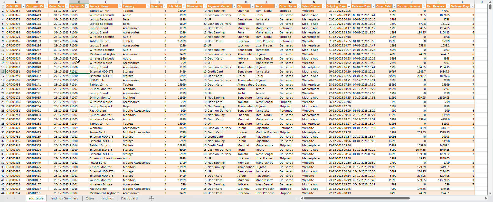

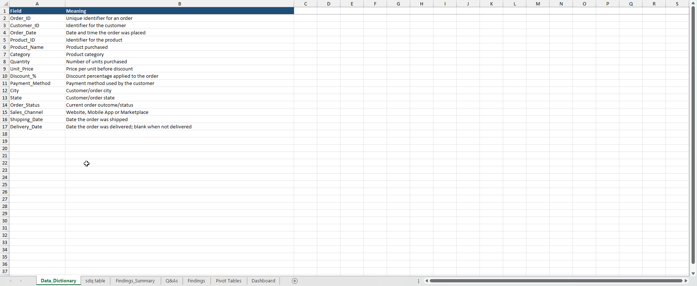

The workbook contains **1,502 order records** covering the 2025 calendar
year, with order-level details such as:

-   Order and customer identifiers
-   Order date
-   Product identifier, product name, and category
-   Quantity, unit price, and discount percentage
-   Payment method and sales channel
-   City and state
-   Order status
-   Shipping and delivery dates

The workbook includes a Data Dictionary sheet describing the dataset
fields. The original source is retained separately from the cleaned
query output.

## Project Workflow

### 1. Data preparation and cleaning with Power Query

The source data was examined and transformed before analysis. The
cleaned Power Query output is stored in the Excel table **`sdq`**.

The preparation work included: - Reviewing missing values and
duplicate/unique identifiers. - Checking text consistency in category,
payment-method, and order-status fields. - Standardizing inconsistent
category capitalization: - `STORAGE` → `Storage` - `ACCESSORIES` →
`Accessories` - `AUDIO` → `Audio` - `BAGS` → `Bags` - `MONITORS` →
`Monitors` - Standardizing the payment method `upi` to `UPI`. - Applying
`Text.Trim` to remove unwanted leading and trailing spaces in
order-status values. - Creating analysis fields for `Gross_Sales`,
`Discount_Amount`, `Net_Revenue`, and delivery duration.

### Power Query Transformations

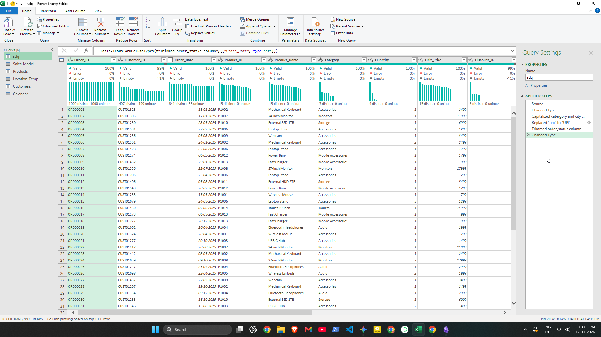

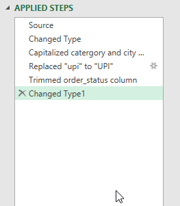

Missing values were investigated rather than automatically replaced: - 3
Customer IDs were missing. - 3 Discount % values were missing. - 423
Delivery Dates were missing.

The missing Customer IDs and Discount % values were retained because
reliable replacement values could not be established. Missing Delivery
Dates were investigated against Order Status.

### 2. Data modelling with Power Pivot

The project uses a fact-and-dimension modelling approach in the Excel
Data Model.

**Fact table** - `Sales_Model` --- order-level sales records used for
measures and analysis.

**Dimension tables** - `Products` --- product-related attributes. -
`Customers` --- customer attributes. - `Calendar` --- a complete date
dimension for the 2025 reporting period.

### Data Model Relationships

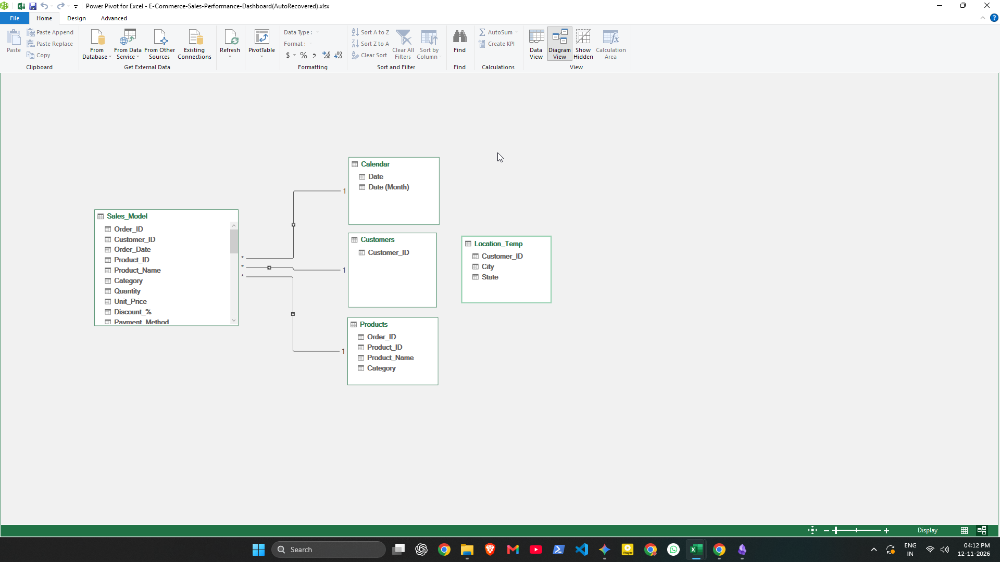

The model was organised to support analysis by date, product, and
customer dimensions. The Calendar table contains 365 dates for 2025.

### 3. DAX calculations

DAX calculated columns were created for sales calculations:

``` dax
DAX_Gross_Sales =
    Sales_Model[Quantity] * Sales_Model[Unit_Price]

DAX_Discount_Amount =
    Sales_Model[Quantity] * Sales_Model[Unit_Price]
        * (Sales_Model[Discount_%] / 100)

DAX_Net_Revenue =
    Sales_Model[DAX_Gross_Sales] - Sales_Model[DAX_Discount_Amount]
```

DAX measures were created for key performance indicators and
order-status analysis, including: - Total Gross Sales - Total Discount
Amount - Total Net Revenue - Delivered Revenue - Total Orders - Average
Order Value - Delivered Orders and Delivered Rate - Cancelled Orders and
Cancellation Rate - Returned Orders and Return Rate - Shipped Orders and
Shipped Rate

### DAX Measures and Calculated Columns

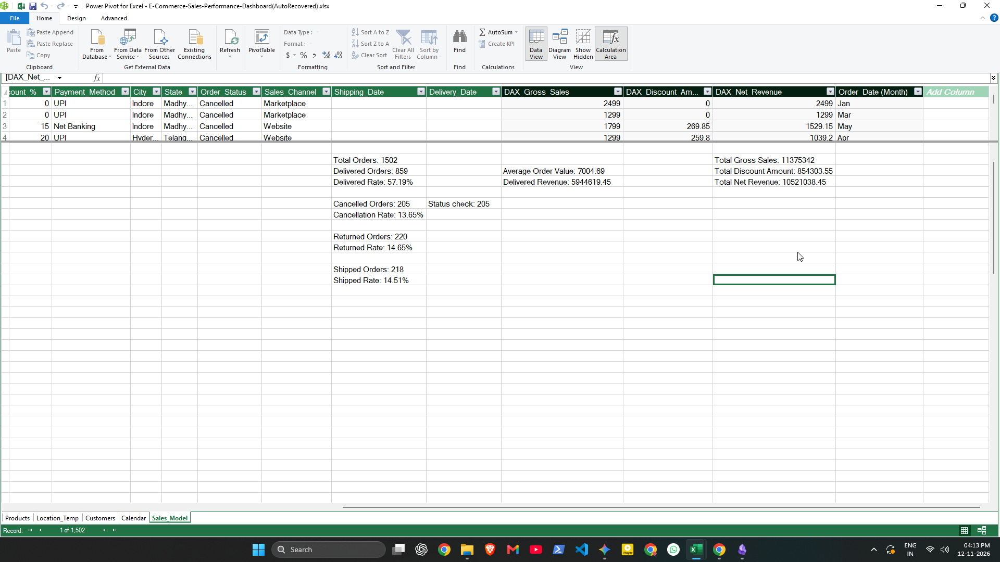

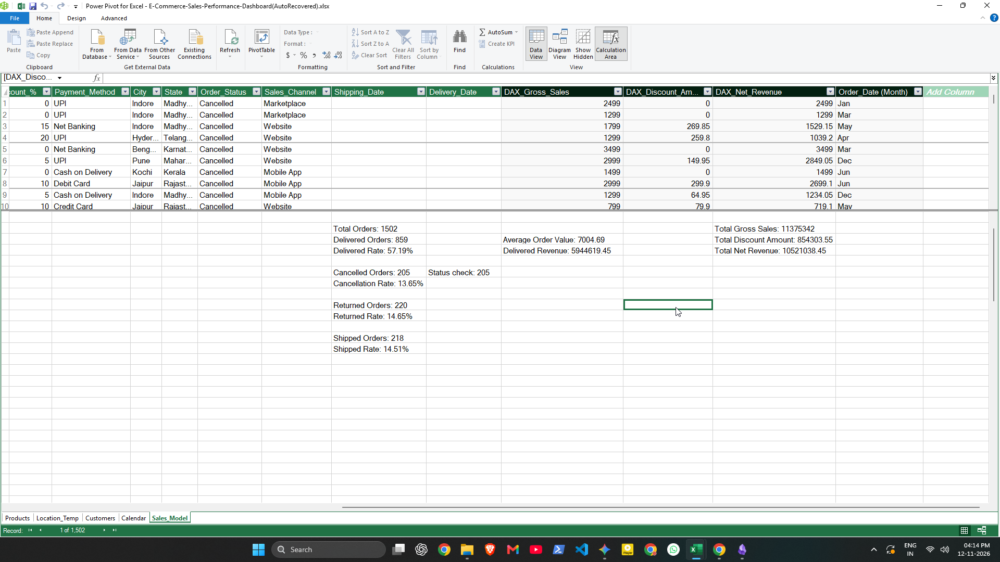

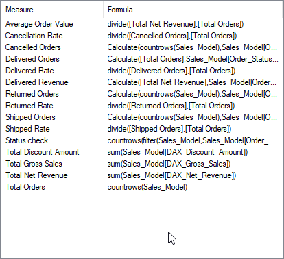

### 4. PivotTables, PivotCharts, and dashboard

PivotTables were used to summarise the data, and PivotCharts were used
to present the results visually.

### Supporting PivotTables

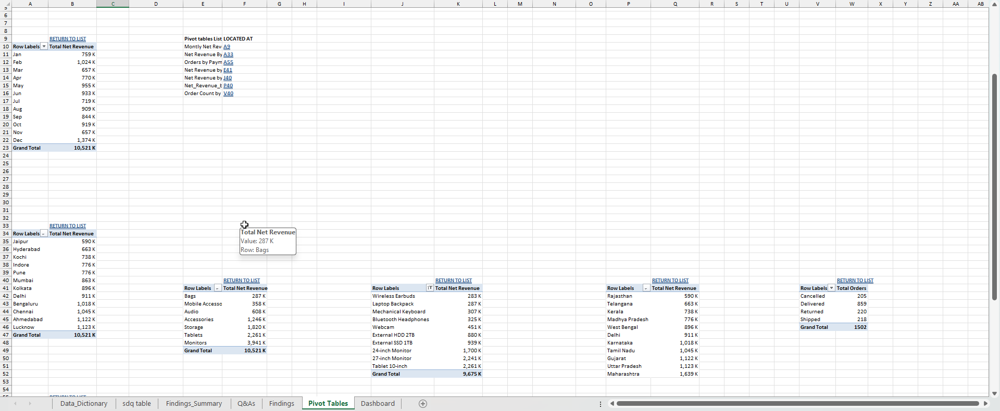

The dashboard includes: - Total Net Revenue - Delivered Revenue - Total
Orders - Average Order Value - Delivered Rate - Delivered Orders -
Monthly Net Revenue Trend - Net Revenue by Product Category - Net
Revenue by City - Order Count by Order Status - Orders by Payment
Method - Top 10 Products by Net Revenue

**Month and City slicers** allow viewers to interactively filter the
dashboard. Supporting PivotTables are kept on a separate worksheet.

## Key Findings

### Data Quality Investigation

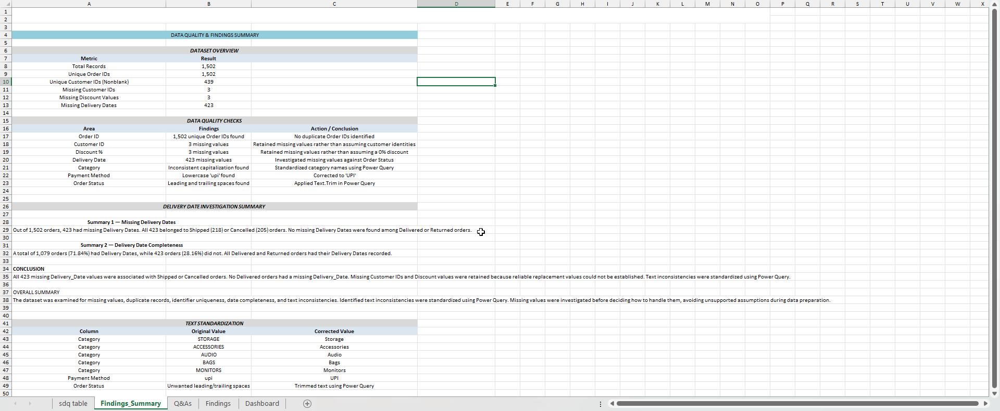

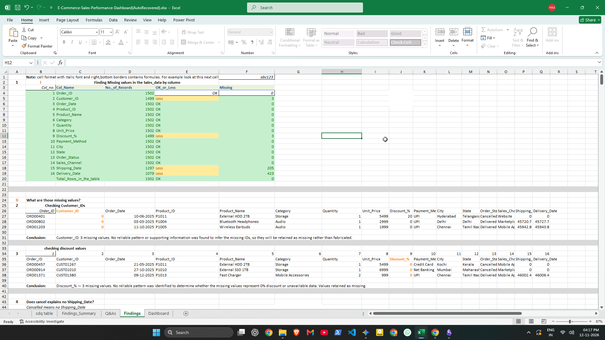

The following figures are based on the workbook's analysis:

  Metric / Finding                           Result
  -------------------------------- ----------------
  Total order records                         1,502
  Unique Order IDs                            1,502
  Unique Customer IDs (nonblank)                439
  Total Net Revenue                  ₹10,521,038.45
  Delivered Revenue                   ₹5,944,619.45
  Average Order Value                     ₹7,004.69
  Delivered Orders                              859
  Delivered Rate                             57.19%
  Missing Customer IDs                            3
  Missing Discount % values                       3
  Missing Delivery Dates                        423

### Order status distribution

  Order Status        Orders      Share
  -------------- ----------- ----------
  Delivered              859     57.19%
  Returned               220     14.65%
  Shipped                218     14.51%
  Cancelled              205     13.65%
  **Total**        **1,502**   **100%**

### Delivery-date investigation

Of the 423 orders with missing Delivery Dates: - 218 were Shipped. - 205
were Cancelled. - No Delivered or Returned orders had a missing Delivery
Date.

A total of 1,079 orders (71.84%) had a recorded Delivery Date, while 423
(28.16%) did not. The missing dates were therefore associated with
Shipped and Cancelled orders in this dataset.

### Other analysis observations

-   December recorded the highest monthly Net Revenue, while November
    recorded the lowest.
-   Lucknow recorded the highest city-level Net Revenue, while Jaipur
    recorded the lowest.
-   Revenue and order activity were also examined by product category,
    payment method, and top-performing products.

These are descriptive findings from this dataset; they do not by
themselves establish the causes of cancellations, returns, or changes in
revenue.

## Excel Functions and Business Q&A Practice

### Excel Formula Practice – Business Q&As

The Q&As worksheet contains practical business questions with Excel formula-based answers, demonstrating the application of Excel functions to real dataset scenarios.

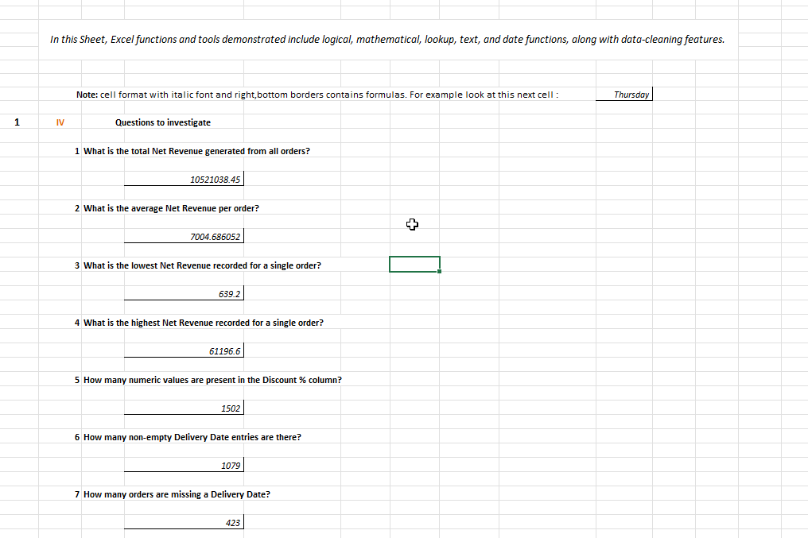

The `Q&As` worksheet contains **53 numbered business-style questions**
with formula-based answers and practical data-tool exercises. It
demonstrates the use of Excel functions across several areas, including:

-   **Math and statistics:** `SUM`, `AVERAGE`, `MIN`, `MAX`, `ROUND`,
    `SUMPRODUCT`, `SUBTOTAL`
-   **Counting and conditional calculations:** `COUNT`, `COUNTA`,
    `COUNTBLANK`, `COUNTIF`, `COUNTIFS`, `SUMIF`, `SUMIFS`, `AVERAGEIF`,
    `AVERAGEIFS`
-   **Logical and error handling:** `IF`, `IFERROR`, `IFNA`, `AND`, `OR`
-   **Lookup and reference:** `VLOOKUP`, `HLOOKUP`, `XLOOKUP`, `INDEX`,
    `MATCH`
-   **Text:** `LEFT`, `RIGHT`, `MID`, `LEN`, `TRIM`, `PROPER`, `UPPER`,
    `LOWER`, `FIND`, `SEARCH`, `CONCAT`, `TEXTJOIN`, `TEXT`
-   **Date and time:** `TODAY`, `NOW`, `DATE`, `YEAR`, `MONTH`, `DAY`,
    `DATEDIF`, `DAYS`, `NETWORKDAYS`, `WORKDAY`, `EOMONTH`, `WEEKDAY`
-   **Data tools:** Remove Duplicates and Text to Columns

The Q&A exercises use the cleaned `sdq` table and related product data
where appropriate. Formula answers are kept separate from the original
source data. The worksheet also includes examples of using a
holiday-date list with `NETWORKDAYS` and `WORKDAY`.

## Workbook Guide

  -----------------------------------------------------------------------
  Worksheet                           Purpose
  ----------------------------------- -----------------------------------
  `Dashboard`                         Interactive sales dashboard with
                                      KPIs, charts, and slicers

  `Findings_Summary`                  Concise overview of data-quality
                                      checks and key findings

  `Q&As`                              Business-style questions, Excel
                                      formula answers, and data-tool
                                      practice

  `Findings`                          Detailed data-quality checks and
                                      supporting analysis

  `sdq table`                         Cleaned Power Query output table
                                      (`sdq`)

  `Pivot Tables`                      Supporting PivotTables used by the
                                      dashboard

  `Data_Dictionary`                   Field names and descriptions

  `Raw_Data`                          Original source data, retained
                                      separately

  `data`                              Supporting source table used by
                                      parts of the workbook
  -----------------------------------------------------------------------

Some supporting worksheets are hidden to keep the workbook easier to
navigate. They are retained because other workbook elements may depend
on them.

## How to Use the Workbook

1.  Open the workbook in Microsoft Excel desktop for the best
    compatibility with Power Query, the Data Model, PivotTables, and
    slicers.
2.  Start with the `Dashboard` worksheet.
3.  Use the Month and City slicers to explore different subsets of the
    data.
4.  Review `Findings_Summary` for the main data-quality results and
    conclusions.
5.  Open `Findings` for detailed checks and supporting evidence.
6.  Visit `Q&As` to inspect the Excel questions and formula-based
    answers. Select a formula answer cell to view its formula in the
    Formula Bar.
7.  If the source data is changed, refresh the relevant queries and
    PivotTables in Excel.

## Repository Contents

``` text
E-Commerce-Sales-Performance-Dashboard/
├── README.md
├── E-Commerce-Sales-Performance-Dashboard.xlsx
└── Pictures/
    ├── dashboard.png
    ├── power-query-cleaning.png
    ├── data-model-relationships.png
    ├── dax-measures.png
    ├── findings-summary.png
    └── q-and-a-formulas.png
```

The image names above are suggested placeholders. Add only the
screenshots that are actually included in the repository, and update the
README image links accordingly.

## Project Objective

This project demonstrates a practical Excel analytics workflow:
preparing raw data, investigating data quality, building a relational
data model, creating DAX calculations, analysing business metrics, and
presenting the results through an interactive dashboard. It also
documents the use of Excel formulas and data tools to answer practical
business questions.
